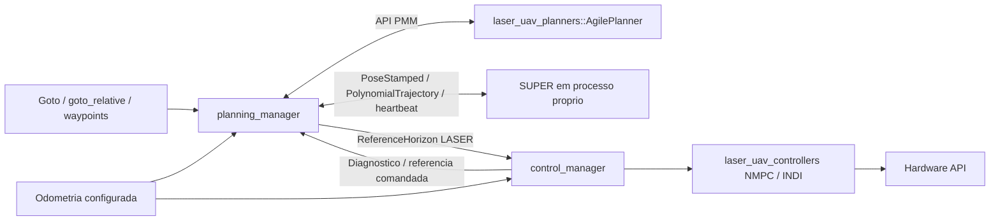

# Auditoria: separar planejamento e controle no LASER UAV System

Data: 2026-10-27. Branch: `dev/separate_planning_and_control`.
Método: Ponytail; leitura dos chamadores e dos caminhos completos de referência.

## O que este pacote faz

O `laser_uav_managers` coordena o controle de voo e a estimação. O controlador
original também gerava trajetórias PMM por meio de
`laser_uav_planners::AgilePlanner`. A carga considerada é um UAV por namespace,
controle externo a 100 Hz e INDI opcional a 250 Hz, com replanejamento enquanto
o veículo está em voo.

Esta branch migra o gerenciador validado no `nmpc_baseline` para os nomes e as
bibliotecas LASER. Não implementa o `planning_manager`. Este documento descreve
a próxima etapa para revisão antes da implementação.

## Resultado da migração já aplicada

- Mantidos `laser_uav_managers::ControlManagerNode`, `control_manager`,
  `laser_msgs` e as classes de `laser_uav_controllers`.
- Removidos do controle `AgilePlanner`, os parâmetros PMM e os callbacks de
  `goto`, `goto_relative` e `trajectory_path`. A dependência
  `laser_uav_planners` saiu deste pacote nesta etapa.
- Mantida a entrada `mars_quadrotor_msgs/PolynomialTrajectory`, incluindo yaw,
  heartbeat correspondente à trajetória e parada de emergência.
- Mantidos os serviços locais de decolagem/pouso, referências comandadas fixas,
  prioridade de pouso/segurança, calibração de massa, NMPC/INDI, TF artificial e
  CSV de benchmark. O diretório padrão do CSV é `/tmp`, sem caminho de usuário.
- Mantidos os arquivos LASER de parâmetros físicos e de ganhos. Nenhum solver,
  modelo, controlador ou estimador foi copiado para dentro deste repositório.
- Mantidos os remapeamentos de IMU/motores do launch original; a fonte de
  odometria passa a ser um argumento explícito. A migração não altera unidades,
  configuração do LIO ou arquivos das sessões de voo.

Até o novo nó existir, navegação PMM por `goto`/waypoints fica indisponível nesta
branch. Uma fonte externa de polinômios, como SUPER, já pode fornecer navegação.
Isso é uma etapa intermediária de desenvolvimento, não substituição pronta de
uma sessão que ainda depende dos comandos PMM antigos.

## Achados que precisam ser resolvidos na próxima etapa

### Obrigatórios para a separação funcionar

1. **Os formatos atuais não representam o mesmo horizonte.**
   - **O que existe:** `AgilePlanner::getTrajectory()` retorna
     `laser_msgs/ReferenceState[]`, com posição, quaternion, velocidades e flags.
     `generateTrajectory()` calcula atitude a partir da aceleração. SUPER
     publica polinômios de posição e yaw; `nav_msgs/Path` contém somente poses.
   - **Problema:** converter PMM apenas para posição/yaw ou usar o Path de debug
     elimina referências que o controlador original recebia.
   - **Correção proposta:** usar um envelope nativo `laser_msgs/ReferenceHorizon`
     para os dois planejadores. Preservar todos os campos de `ReferenceState`.
     O novo tipo exige mudança separada no repositório `laser_msgs`.
   - **Se ignorado:** a troca de planejador também muda silenciosamente o
     problema de tracking, mesmo com o mesmo NMPC e os mesmos ganhos.

2. **Executar PMM e publicar o horizonte no mesmo callback interrompe o fluxo.**
   - **O que existe:** `AgilePlanner::generateTrajectory()` executa otimização
     síncrona e limpa os buffers ativos antes de reconstruí-los. O sampler
     também modifica o relógio inicial e o estado de hover.
   - **Problema:** uma geração que demore mais que o timeout interrompe a
     referência. Chamar geração e sampling simultaneamente na mesma instância
     também não é seguro.
   - **Correção proposta:** geração em um worker do processo de planejamento,
     preparando outra instância; o timer continua publicando a trajetória
     anterior. Substituir a instância ativa somente quando a nova estiver pronta.
     Nenhum worker ou mutex adicional entra no loop do `control_manager`.
   - **Se ignorado:** uma meta nova pode causar hold inesperado ou acesso a
     buffers sendo reconstruídos. Separar os processos, sozinho, não resolve
     a interrupção da publicação pelo próprio planejador.

3. **Receber N+1 pontos não garante cobertura do horizonte no instante de uso.**
   - **O que existe:** o controlador usa `N` e `dt`; SUPER usa início absoluto
     do polinômio, e PMM ancora o tempo na primeira chamada de sampling.
   - **Problema:** com atraso de transporte, o último ponto de um pacote N+1
     já antecede o final da grade `now + N * dt` do controle. Heartbeat ativo
     também não garante cobertura temporal nem polinômio correspondente.
   - **Correção proposta:** declarar o instante do primeiro ponto no header,
     `dt`, identidade e cobertura. Publicar ao menos N+2 pontos para a operação
     nominal; o consumidor alinha a grade temporal e exige cobertura completa.
     Se a janela acabar, manter a última referência comandada. Usar relógio ROS
     comum; timeout de chegada usa relógio monotônico, como na migração atual.
   - **Se ignorado:** atraso ou perda de mensagens vira atraso de referência,
     extrapolação implícita ou repetição incorreta do fim de cada horizonte.

4. **Os dois nós não podem disputar intenção e estado de voo.**
   - **O que existe:** o controle original recebia metas, gerava trajetórias e
     administrava decolagem/pouso. SUPER tem outra máquina de estados e aceita
     metas por `geometry_msgs/PoseStamped`.
   - **Problema:** encaminhar metas durante pouso, aceitar dois produtores ou
     reusar uma trajetória da sessão anterior pode mudar a referência durante
     uma manobra local.
   - **Correção proposta:** `planning_manager` possui as metas; `control_manager`
     possui autoridade de voo e segurança. Ler seu diagnóstico e referência
     comandada. Liberar navegação depois da decolagem/calibração; pouso cancela
     a missão e invalida seu identificador. Selecionar exatamente uma entrada
     de referência e um planejador na configuração, sem troca automática.
   - **Se ignorado:** referências antigas ou metas concorrentes podem interromper
     decolagem, pouso ou hold.

5. **Frames e configurações de simulação não podem ser presumidos no adaptador.**
   - **O que existe:** o launch experimental do baseline usa defaults como
     `/uav1/ground_truth`; SUPER publica header `world`; a ponte de nuvem calcula
     coordenadas pela odometria e pode escrever outro nome no header.
   - **Problema:** trocar apenas o nome do frame não transforma coordenadas.
     Uma fonte diferente no planejador e no controlador invalida a comparação.
   - **Correção proposta:** um único argumento de odometria/frame por sessão,
     propagado aos nós; conferir TF, unidades e timestamps da nuvem e da IMU.
     Preservar a TF artificial solicitada, sem usá-la para reancorar metas.
     A conversão de nuvens fica fora do processo de controle.
   - **Se ignorado:** oscilação ou drift podem ser atribuídos ao controlador
     quando planejador, nuvem e estado usam bases incompatíveis.

6. **PMM e SUPER não têm a mesma interface de missão.**
   - **O que existe:** PMM aceita listas de waypoints, velocidade e parada nos
     pontos. A interface ROS 2 do SUPER inspecionada aceita uma pose de destino.
     O PMM atual também zera a velocidade inicial em `generateTrajectory()`.
   - **Problema:** repassar uma lista ao SUPER como se fosse uma única meta
     perde parte da missão. Replanejar PMM em movimento presumindo repouso
     não assegura continuidade de velocidade.
   - **Correção proposta:** preservar a fila/semântica PMM no novo nó; para SUPER,
     suportar meta única e sequenciamento com parada, e rejeitar explicitamente
     fly-through multiponto até existir suporte verificado. Antes de prometer
     replanejamento PMM suave, tratar a velocidade inicial no pacote do planejador
     ou restringir a troca a um estado compatível. Essa decisão integra a revisão.
   - **Se ignorado:** uma seleção de backend muda o caminho solicitado ou
     introduz descontinuidade sem avisar o operador.

7. **A calibração de massa deixa de chegar ao objeto PMM por chamada direta.**
   - **O que existe:** o gerenciador original chama `setMass()` no controlador
     e no `AgilePlanner`; a migração preserva a atualização do NMPC. A massa
     calibrada já é publicada em `UavControlDiagnostics.estimated_mass`.
   - **Problema:** mover o objeto PMM sem mover essa informação deixa seus
     parâmetros físicos diferentes dos usados pelo controle.
   - **Correção proposta:** carregar o mesmo YAML físico e atualizar a massa PMM
     pelo diagnóstico após a calibração, antes de aceitar a próxima missão.
     Não transformar isso em adaptação contínua ou reancoragem por odometria.
   - **Se ignorado:** referências e diagnóstico deixam de reproduzir os dados
     físicos do fluxo original.

8. **O benchmark atual observa uma meta SUPER, não uma missão PMM.**
   - **O que existe:** a execução começa ao receber `PoseStamped` em `/goal_pose`
     e grava `waypoint_count=1`. Metas PMM têm outro tipo e podem conter vários
     pontos. Parada de emergência não é conclusão normal.
   - **Problema:** adicionar PMM sem eventos comuns deixa de iniciar o CSV ou
     contabiliza a missão incorretamente. Reutilizar o mesmo tópico como entrada
     e saída do adaptador também pode realimentar/resetar a própria meta.
   - **Correção proposta:** o planejamento publica um evento de missão aceita
     e seu estado terminal/abort, com identificador e quantidade de waypoints;
     o observador mantém o esquema CSV existente. Separar a entrada de meta do
     SUPER da saída de eventos. Definir esse metadado junto ao contrato nativo,
     antes de implementar o benchmark PMM; não inferir missão por heartbeat.
   - **Se ignorado:** a validação passa a comparar métricas diferentes entre
     backends, ou registra um abort como navegação concluída.

## Arquitetura recomendada



As setas PMM e SUPER representam alternativas de configuração, não dois
produtores ativos. `planner: pmm` será o padrão para preservar a opção LUS;
`planner: super` selecionará o processo externo e seu adaptador. Não proponho
framework de plugins, carregamento dinâmico ou uma hierarquia genérica de backends.

### Convenções de nomes e divisão de arquivos

- Pacote existente: `laser_uav_managers`; namespace C++ `laser_uav_managers`.
- Classe `PlanningManagerNode`, arquivos `planning_manager_node.hpp/.cpp`,
  `planning_manager_main.cpp`, executável `planning_manager` e componente
  `laser_uav_managers::PlanningManagerNode`.
- Launch `planning_manager.launch.py`, parâmetros `params/planning_manager.yaml`.
  Reusar os YAML físicos, PMM e N/dt existentes, sem duplicar ganhos ou solver.
- Entradas relativas `goto_in`, `goto_relative_in`, `trajectory_path_in`,
  `odometry_in`, `control_diagnostics_in`; saída `reference_horizon_out`.
- O launch poderá manter os tópicos públicos antigos
  `/<uav>/control_manager/goto`, `goto_relative` e `trajectory_path`, com o
  subscriber pertencendo ao novo nó. Os nomes do operador não exigem relays.
- Manter publishers, estado e buffers por UAV; retirar os defaults globais
  de tópicos do SUPER na integração, por remapeamento explícito.

### Contrato proposto para revisão

```text
# laser_msgs/msg/ReferenceHorizon.msg -- proposta, nao implementada
std_msgs/Header header                 # frame e instante do primeiro ponto
uint32 trajectory_id
float64 dt
laser_msgs/ReferenceState[] reference_horizon
bool terminal                         # estado final, velocidades zeradas
```

O consumidor valida número de pontos, cobertura temporal, finitude, quaternion,
frame e compatibilidade de `dt`. A origem da referência local continua sendo
inicializada uma vez. Alinhamento temporal/interpolação de referências recebidas
não é replanejamento; a matemática de geração fica no processo de planejamento.

PMM usa `getTrajectory()` com a grade necessária. O adaptador SUPER reutiliza o
sampler e os testes de polinômio desta migração; apenas heartbeats da trajetória
armazenada mantêm sua validade. `EMER_STOP` vira hold da última referência
comandada, sem capturar a posição medida como nova meta. Retomada exige uma nova
trajetória válida. `terminal` só é emitido para conclusão normal, não para abort.

Durante a transição, preservar o assinante `PolynomialTrajectory` do controle
como entrada legada selecionável, mutuamente exclusiva com o horizonte LASER.
Não remover a compatibilidade SUPER solicitada. O novo tipo nativo e a seleção
de entrada serão implementados somente na próxima etapa, junto com seus testes.

### Plano de implementação

1. Revisar este contrato e os limites de missão; adicionar o envelope em
   `laser_msgs` numa branch correspondente. Não renomear mensagens existentes.
2. Criar o lifecycle `planning_manager` e a opção PMM, movendo os callbacks e a
   fila de navegação. Preservar takeoff/landing/hold no controle. Medir geração
   PMM e manter publicação enquanto a próxima trajetória é preparada.
3. Adicionar o adaptador SUPER e seu launch condicionado à seleção. A opção
   PMM deve iniciar sem o pacote `super_planner` instalado; não resolver seu
   caminho ou carregar seu código quando não selecionado.
4. Adicionar o consumidor de horizonte no controle, com seleção exclusiva da
   entrada legada, mantendo hardware, referência fixa, TF e benchmark.
5. Atualizar sessões e TUI por remapeamento; executar testes e SITL comparáveis
   com os mesmos parâmetros físicos, odometria, relógio e perfil de referência.

### Critérios de aceite

- PMM e SUPER iniciam separadamente e fornecem posição, atitude e velocidades
  sem o controle instanciar um planejador ou esperar sua otimização.
- Nenhum drift da referência em hold, decolagem ou pouso com odometria variando.
- Cobertura do horizonte validada sob atraso/perda; heartbeat de outra trajetória
  não mantém referência antiga ativa. Fim normal e abort não são confundidos.
- Um objetivo durante pouso não altera a manobra; desativar/reconfigurar não
  reutiliza metas anteriores; existe somente uma autoridade de referência.
- PMM preserva waypoints, heading e parada; modos SUPER não suportados são
  rejeitados com motivo explícito. Calibração chega ao PMM sem afetar a âncora.
- Medir intervalo real de publicação, p95/p99 e deadline miss nos dois modos.
  Tempo interno do solver, sozinho, não mede frequência do loop.
- TF artificial e CSV continuam disponíveis, com uma linha por missão concluída.

## Validação e limites desta auditoria

A migração compila contra as bibliotecas LASER instaladas e passa os 19 testes
de horizonte, incluindo uma chamada ao NMPC original. Builds e testes foram
isolados em `/tmp/laser_separate_planning_*`; o checkout original e a instalação
usada pelas sessões de voo não foram substituídos.

| Verificação executada | Resultado |
| --- | --- |
| Build/instalação via colcon, configuração Release | Passou |
| GTest `test_reference_horizons` | 19 testes, zero falhas |
| cppcheck, lint CMake e pep257 do pacote | Passaram |
| Uncrustify dos três arquivos C++ migrados | Passou |
| Flake8 do launch de controle alterado | Passou |
| Argumentos/defaults do launch, YAML e manifesto ROS | Passaram |
| Flake8 do pacote inteiro | Falha em imports do PlotJuggler e linha longa do launch de estimação, sem alterações nesta branch |
| Uncrustify do pacote inteiro | Falha nos dois arquivos de estimação, sem alterações nesta branch |
| xmllint do manifesto | Bloqueado ao buscar `package_format3.xsd` pela rede; parsing XML e validação pelo `catkin_pkg` passaram |

A resolução dinâmica após o build colcon foi conferida: o core do controle
vem do install isolado novo; `liblaser_uav_controllers`, solver gerado e
`libacados` vêm do LUS instalado. A suíte completa não está inteiramente verde
pelos três grupos acima; seus resultados estão em
`/tmp/laser_separate_planning_logs/ctest.log`.

Foram lidos o controle original, o baseline validado, seus testes, as mensagens
LASER, os caminhos de geração/sampling do AgilePlanner e a interface ROS 2 do
SUPER. Não foi auditado todo o otimizador PMM, todo o SUPER ou a estimação.

Os limites herdados de falha do solver, ausência de watchdog de odometria,
validação completa de dimensões e propriedade da cápsula ACADOS não são
corrigidos nesta migração. A revisão anterior os manteve fora de escopo.

**Veredito:** manter esta etapa como migração de controle; implementar o novo
nó depois de revisar o contrato e os achados 1 a 8. Não adicionar outra cópia
de NMPC, INDI ou solver ao `planning_manager`.

**Não verificado:** SITL da nova branch, voo real e medidas de jitter sob PMM e
SUPER no novo processo, que ainda não existe. Passar os testes locais não
substitui essa validação de integração.
